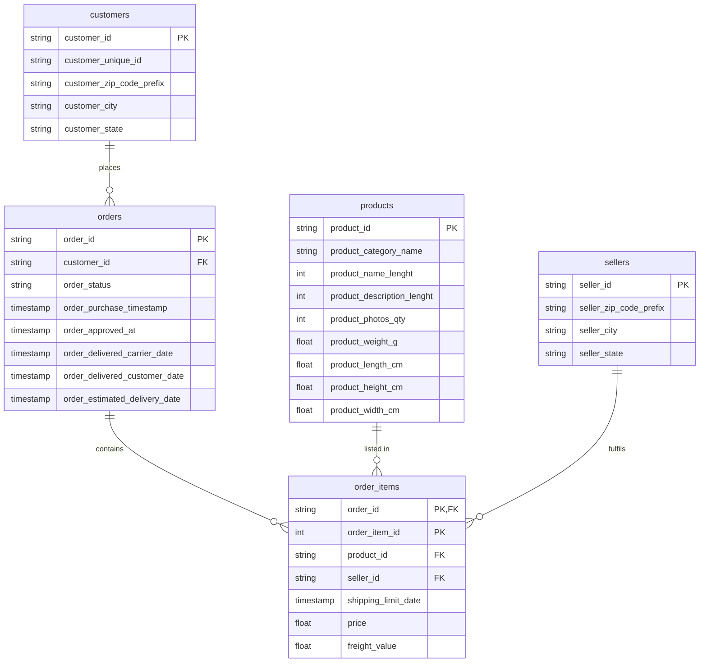

# Olist ERD – Five Tables (Crow's Foot Notation)

## Cardinality notes (derived from data)

| Relationship | Min children | Max children | Notation |
|---|---|---|---|
| customers → orders | 1 | 1 | `\|\|--o{` (every customer_id appears in exactly one order row, but a person may re-order under a new customer_id) |
| orders → order_items | 0 | 21 | `\|\|--o{` (775 orders have zero items) |
| products → order_items | 0 | 527 | `\|\|--o{` (some products were never sold) |
| sellers → order_items | 0 | many | `\|\|--o{` (some sellers have no items in the data) |

> The circle (o) on the "many" end expresses **zero-or-many**, which the data supports:
> orders without items and products/sellers with no associated order_items both exist.
